# SDK Example — a guided tour of the POE1Fixer plugin SDK

The reference plugin for the POE1Fixer plugin SDK (ABI v1). It is a tour in 24 lessons: open
its panel in the app's **Plugins** tab, pick a lesson on the left, and the page shows one part of
the SDK working on live game data.

Every lesson page has the same five parts, always in this order:

1. **Title and summary**: what the lesson teaches, in one line.
2. **What / When / Limits**: what the API does, when a plugin should use it, and the limits the
   app enforces, in numbers.
3. **Status line**: never blank. Either `Live: <the key fact>`, or the exact reason the demo is
   empty right now (`Not in game: P1_SNAP_IN_GAME is off`, `Buffs are read only while the app's
   AutoPot runs`, `"Allow input" is off for this plugin`, ...).
4. **The demo**: the smallest UI that shows the API working.
5. **Source chip and Copy snippet**: the file, line and function the lesson's code lives in, and a
   button that puts that code on the clipboard (Show code displays it). A short copy of the chip
   sits at the right end of the title line; a click on it opens the code. The snippet is a
   verbatim excerpt of the lesson's own code, which is compiled with the plugin and copied into
   the DLL by `tools/gen_snippets.py`, so it cannot drift. Most snippets use only the SDK and
   ImGui; some call this example's small helpers (`Fmt`, the `ui::` kit, `App`), which are in this
   folder too. The Lifecycle snippet is a whole minimal plugin that compiles on its own.

The full developer guide (sandbox, lifecycle, snapshot reference, drawing limits, input, memory
reads, debugging, versioning, FAQ) is [docs/PluginDevelopmentGuide.md](../../docs/PluginDevelopmentGuide.md)
(in Russian: [docs/PluginDevelopmentGuide_ru.md](../../docs/PluginDevelopmentGuide_ru.md)).

## Screenshots

Taken by the app's `--pluginshot` tool (a debug build only): the plugin runs in the real plugin
host and sandbox, fed a synthetic in-game snapshot (The Coast, 45 entities, buffs, inventory, map
elements, a made-up area terrain and quest log for the radar; made-up bytes behind the memory
anchors), and the app's render plane draws its panel
in the dark theme and its overlay over a neutral backdrop. No game was running.

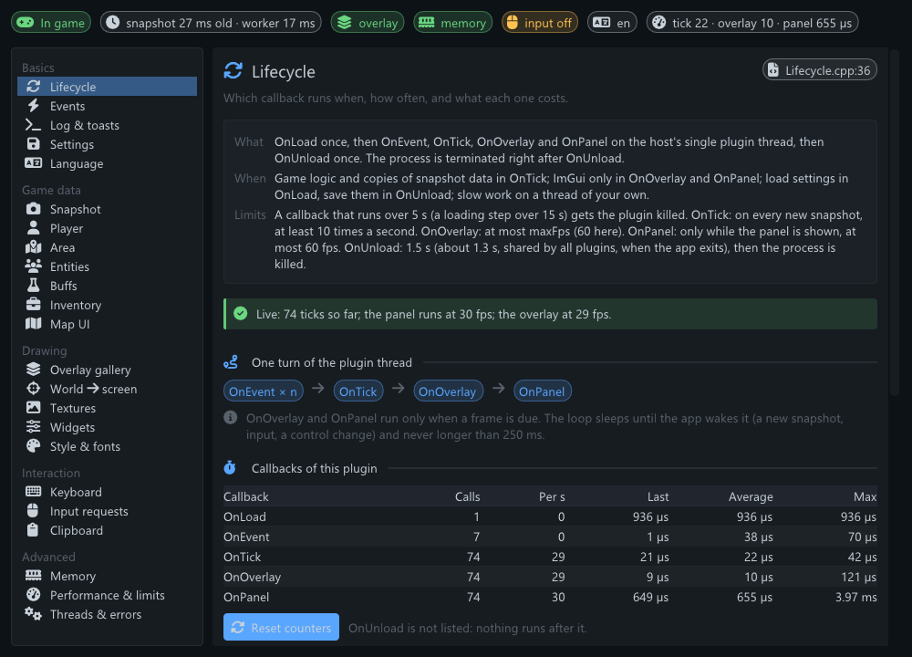
*Lifecycle. Every page: title and summary (with the source chip at the right of the title), What /
When / Limits, a live status line, the demo, and at the bottom the full source chip with Copy
snippet.*

| | |
|---|---|
| 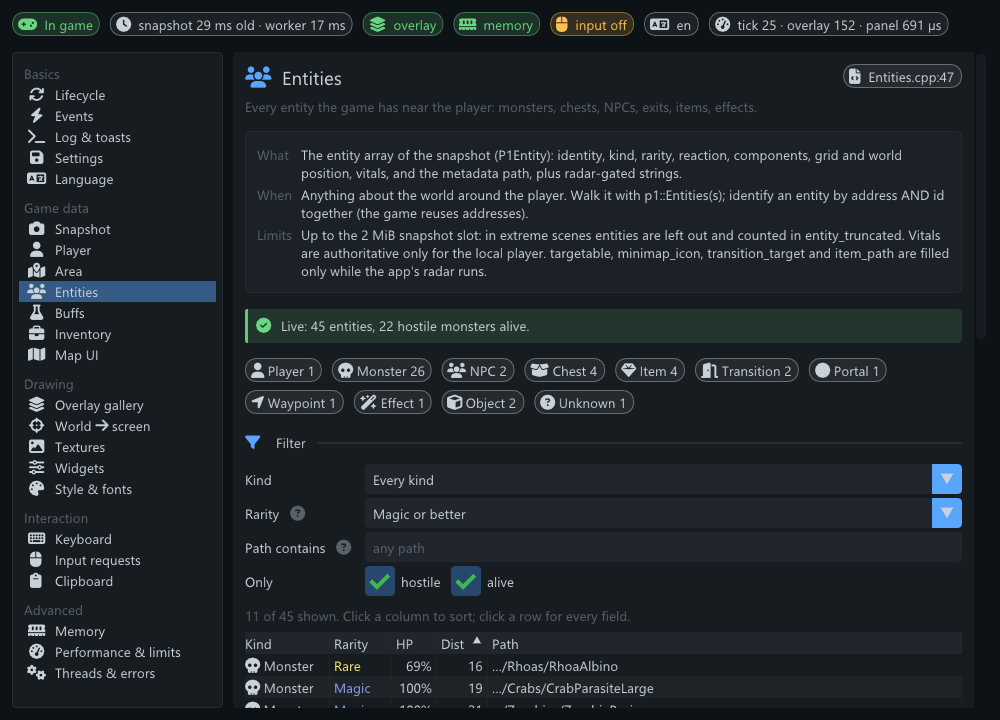 | 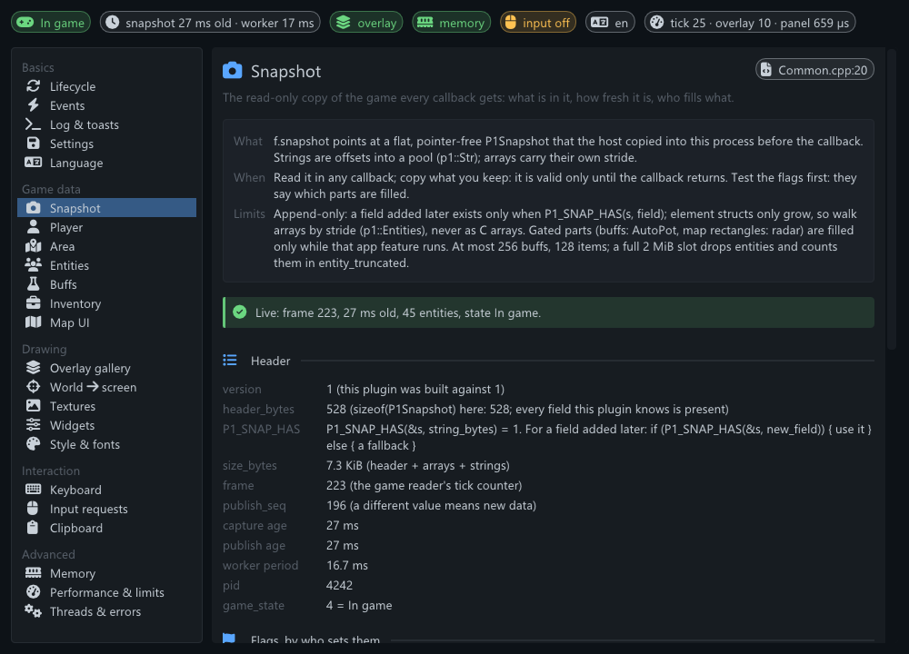 |
| **Entities**: counts by kind, a filter form, a sortable clipped table; the overlay rings the entity the card shows. | **Snapshot**: the header, every flag with who sets it, the server values, the arrays and their strides. |
| 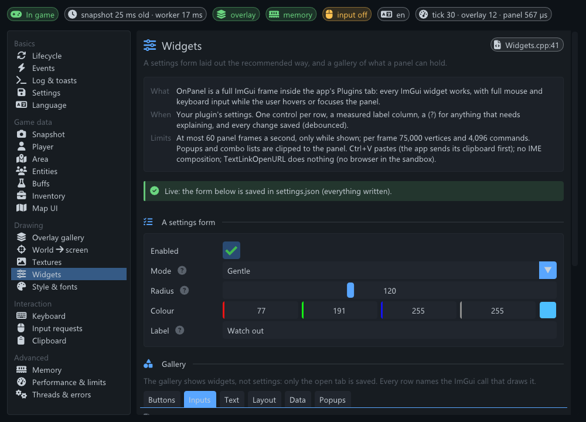 | 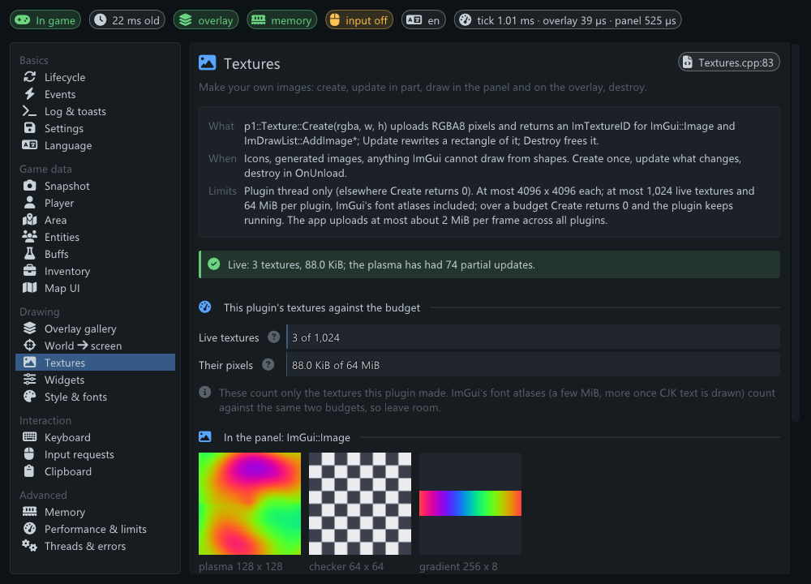 |
| **Widgets**: the recommended settings form (measured labels, help markers), then a gallery in tabs. | **Textures**: the plugin's textures against the 1,024 / 64 MiB budget, and the animated plasma. |
| 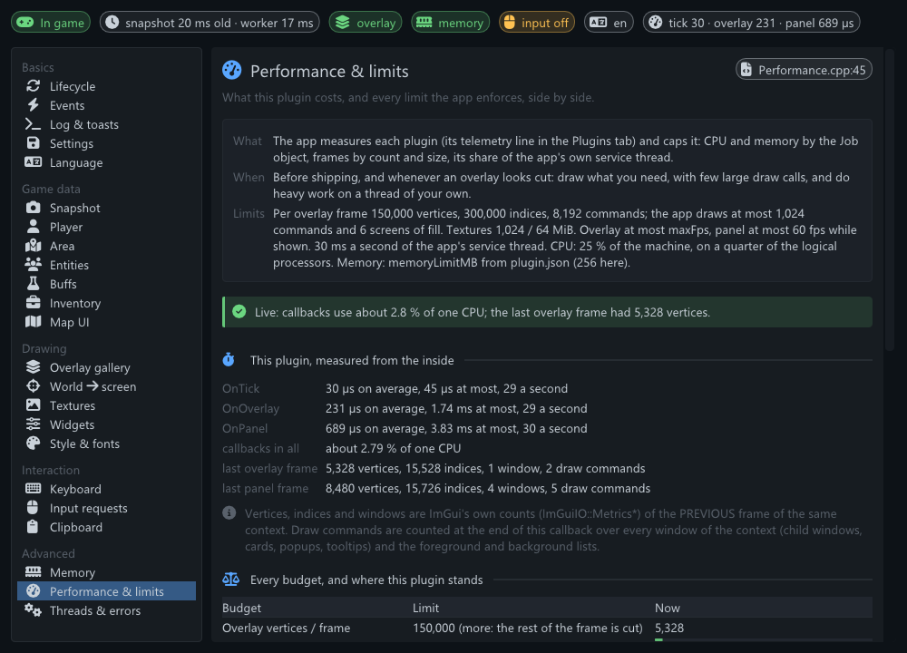 | 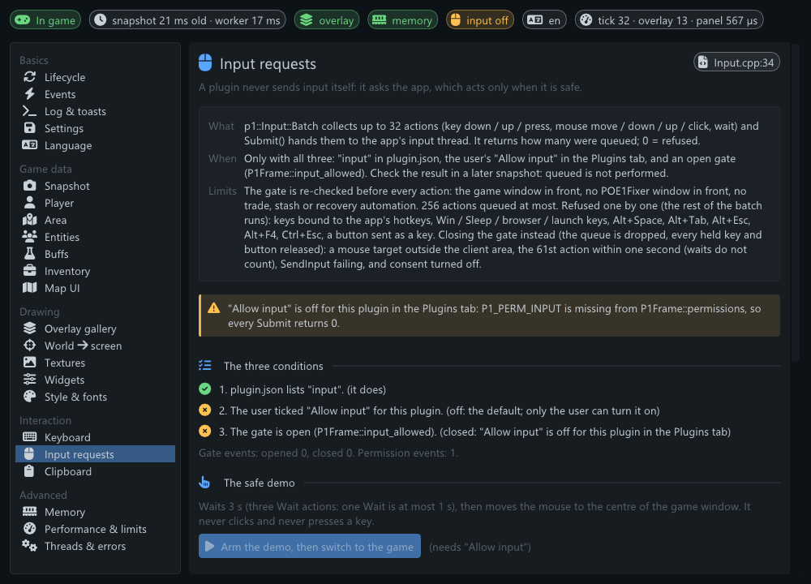 |
| **Performance & limits**: this plugin's costs from the inside, then every app budget with a usage bar. | **Input requests**: the three conditions, why the gate is closed right now, and the safe demo. |
| 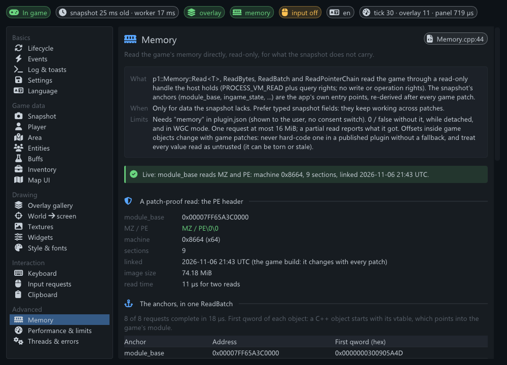 | 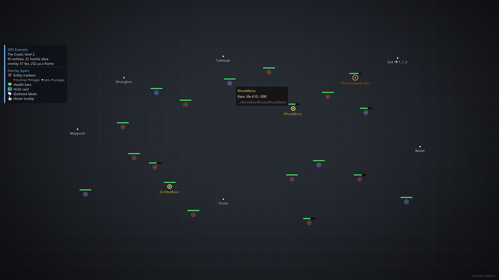 |
| **Memory**: a patch-proof PE header read, one `ReadBatch` of the anchors, a hex viewer, a pointer chain. | **Overlay**: rarity markers, health bars, outlined labels, the HUD card with its legend, a hover tooltip. |
| 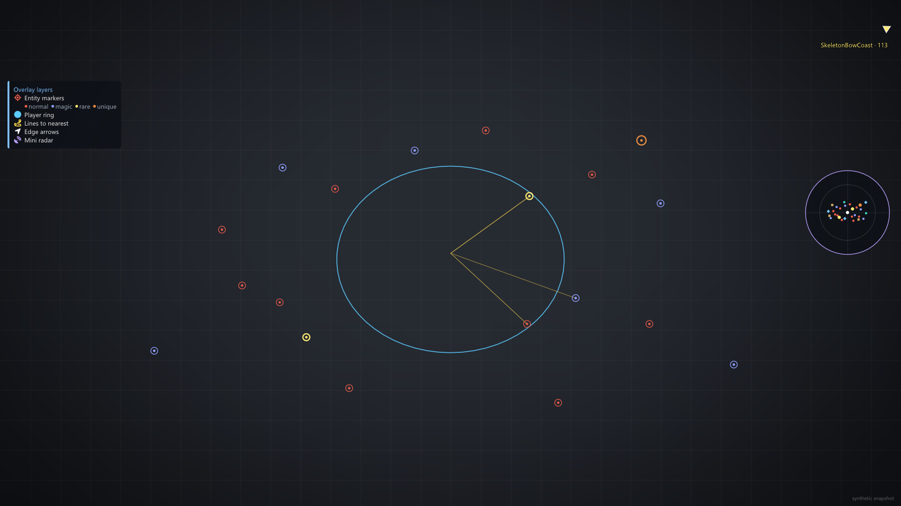 | 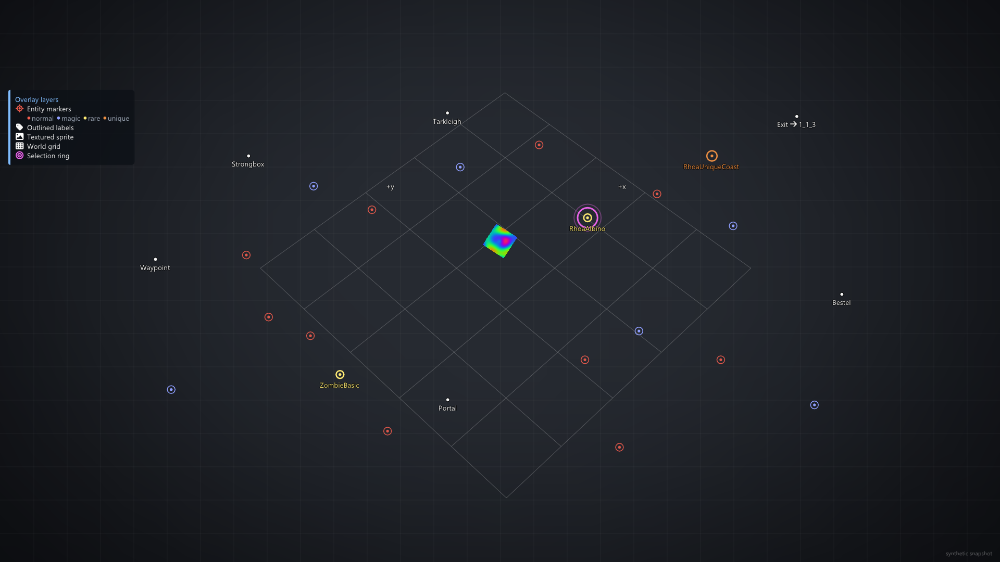 |
| **Overlay**: a world-space ring, lines to the nearest monsters, a labelled edge arrow, the mini radar. | **Overlay**: the projected 5 x 5 world grid, the Entities lesson's selection ring, a textured sprite. |

## The lessons

| # | Lesson (id) | File | What it shows |
|---|---|---|---|
| | **Basics** | | |
| 1 | Lifecycle (`lifecycle`) | [Lifecycle.cpp](src/lessons/Lifecycle.cpp) | Which callback runs when; calls, rate and cost of each; the P1Frame fields; `p1::RequestFrames` |
| 2 | Events (`events`) | [Events.cpp](src/lessons/Events.cpp) | Every `P1_EV_*` decoded, counted, and the last 50 with their age |
| 3 | Log & toasts (`logging`) | [Logging.cpp](src/lessons/Logging.cpp) | A log line per level, a toast per level, a 250-line burst; where each line ends up |
| 4 | Settings (`settings`) | [Settings.cpp](src/lessons/Settings.cpp) | `p1::Settings` Load / Save, the debounced save, the `.rejected` rule step by step |
| 5 | Language (`language`) | [Language.cpp](src/lessons/Language.cpp) | `HostApi().language`, `P1_EV_LANGUAGE`, a string table in all 9 app languages with an English fallback |
| | **Game data** | | |
| 6 | Snapshot (`snapshot`) | [Snapshot.cpp](src/lessons/Snapshot.cpp) | The header, every flag and who sets it, server values, the arrays and their strides |
| 7 | Player (`player`) | [Player.cpp](src/lessons/Player.cpp) | Life / energy shield / mana bars with reservation, regeneration, position, facing, action ids |
| 8 | Area (`area`) | [Area.cpp](src/lessons/Area.cpp) | The current area, and the last 10 areas from `P1_EV_AREA_CHANGED` |
| 9 | Entities (`entities`) | [Entities.cpp](src/lessons/Entities.cpp) | Filtered, sorted, clipped entity table; every field of one entity; a selection ring on the overlay |
| 10 | Buffs (`buffs`) | [Buffs.cpp](src/lessons/Buffs.cpp) | Buff timers, charges, flask slots (gated: AutoPot) |
| 11 | Inventory (`inventory`) | [Inventory.cpp](src/lessons/Inventory.cpp) | The 12 x 5 grid from `inv_occupied` and the item array |
| 12 | Map UI (`mapui`) | [MapUi.cpp](src/lessons/MapUi.cpp) | The minimap's rectangle and the large map's centre and scale (its `pos` is the centre, its size reads 0 x 0), drawn to scale (gated: radar) |
| | **Drawing** | | |
| 13 | Overlay gallery (`overlay`) | [Overlay.cpp](src/lessons/Overlay.cpp) | Ten overlay layers, each with its own colour and size, and a HUD card with a legend |
| 14 | World → screen (`w2s`) | [WorldToScreen.cpp](src/lessons/WorldToScreen.cpp) | `p1::WorldToScreen`, the camera, a point to move by hand, a projected 5 x 5 ground grid |
| 15 | Textures (`textures`) | [Textures.cpp](src/lessons/Textures.cpp) | Procedural textures, an animated plasma by partial `Texture::Update`, the 1,024 / 64 MiB budget |
| 16 | Widgets (`widgets`) | [Widgets.cpp](src/lessons/Widgets.cpp) | The recommended settings form, and a gallery of ImGui widgets in a panel |
| 17 | Style & fonts (`style`) | [Style.cpp](src/lessons/Style.cpp) | The app theme's colours and sizes, the plugin's own semantic colours, icons, every script |
| | **Interaction** | | |
| 18 | Keyboard (`keyboard`) | [Keyboard.cpp](src/lessons/Keyboard.cpp) | `p1::KeyEdge` with a live key-cap grid, and a bindable hotkey that toggles an overlay layer |
| 19 | Input requests (`input`) | [Input.cpp](src/lessons/Input.cpp) | The three conditions, the gate, and a SAFE demo: three waits, then one mouse move (no click, no key) |
| 20 | Clipboard (`clipboard`) | [Clipboard.cpp](src/lessons/Clipboard.cpp) | Copy through the app, paste into the panel, and the clipboard gate |
| | **Advanced** | | |
| 21 | Memory (`memory`) | [Memory.cpp](src/lessons/Memory.cpp) | The PE header at `module_base`, a `ReadBatch` of the anchors, a hex viewer, a pointer-chain reader |
| 22 | Performance & limits (`performance`) | [Performance.cpp](src/lessons/Performance.cpp) | This plugin's costs, every budget the app enforces side by side, a bounded overlay stress test |
| 23 | Threads & errors (`threads`) | [Threads.cpp](src/lessons/Threads.cpp) | A worker thread done right, which calls work from which thread, an exception thrown inside OnPanel |
| 24 | Build a radar (`maprad`) | [MapRadar.cpp](src/lessons/MapRadar.cpp) | A radar of your own (permission `radar`): the area's walls as one texture (`p1::TerrainTexture`), entities by the app's radar category, the player, the exits, on the game's large map, its minimap or a panel; why there is data or not (gate and stages); a live preview in the panel |

The overlay layers (ids, used by settings.json): `markers`, `health`, `ring`, `lines`, `arrows`,
`hud`, `labels`, `tooltip`, `radar`, `sprite` (Overlay gallery), `grid` (World → screen),
`selection` (Entities). The Build a radar lesson is not a layer: its radar on the game's maps has a
switch of its own, `lessons.maprad.on` (so `"all": true` leaves it off), and the lesson id is
`maprad`, not `radar` (the mini radar layer above).

## How the code is laid out

```
plugin.json                 the manifest
src/Plugin.cpp              the p1::Plugin subclass, P1_PLUGIN, routing every callback to the
                            lessons, settings.json (load in OnLoad, debounced save on the worker)
src/App.h / App.cpp         what the lessons share: settings state, callback timing, overlay
                            layers, the event log, the area history, the selection, textures,
                            the worker thread
src/Shell.cpp               the panel: status strip, lesson list, the five parts of a page
src/lessons/Lesson.h        the Lesson base class and the LessonInfo of every page
src/lessons/<Lesson>.cpp    one lesson per file; each is complete on its own (its demo, its
                            overlay drawing, its events, its settings)
src/lessons/Common.*        why game data is missing right now, status-line helpers
src/ui/Ui.h / Ui.cpp        the mini UI kit: card, section title, key / value table with a
                            measured label column, settings form, chip, status line, meter,
                            usage bar, code block, help marker, right-aligned table numbers,
                            text that wraps between words only, a wrapping flow layout,
                            semantic colours
src/generated/Snippets.inc  generated by tools/gen_snippets.py: do not edit
tools/gen_snippets.py       copies every "// [snippet:<id>]" block into Snippets.inc
```

A shared piece is implemented in the lesson that teaches it: `TextureSet` in
`lessons/Textures.cpp`, `Worker` in `lessons/Threads.cpp`, `CallbackStats` in
`lessons/Lifecycle.cpp`. The UI kit takes every size from `ImGui::GetStyle()` and the font size,
and every colour from the app's theme except a few that carry a meaning (ok / warning / error,
item rarity), so the panel follows the theme and the UI scale.

## Build

Requirements: Visual Studio 2022 (v143), x64, C++20.

1. Inside this repository: build `Plugins\ExamplePlugin\ExamplePlugin.vcxproj` (or the solution).
   The output is `x64\<Configuration>\Plugins\ExamplePlugin\` with `ExamplePlugin.dll` and
   `plugin.json`. The project builds at `/W4` with no warnings.
2. After you change code between snippet markers, regenerate the snippet table:
   `python tools\gen_snippets.py` (Python 3, standard library only). `python tools\gen_snippets.py
   --check` exits non-zero when `src/generated/Snippets.inc` is stale; the generated file is
   committed, so building needs no Python.
3. In your own project, mirror what `ExamplePlugin.vcxproj` does:
   - include directories `PluginSDK\include` and `PluginSDK\imgui`;
   - compile the SDK's pinned ImGui core INTO your DLL: `PluginSDK\imgui\imgui.cpp`,
     `imgui_draw.cpp`, `imgui_tables.cpp`, `imgui_widgets.cpp` (no backends). Use exactly that copy
     and its `imconfig.h`: the host refuses a plugin whose ImGui version or struct layout differs;
   - `#include <p1sdk/p1sdk.hpp>`, derive from `p1::Plugin`, and end one .cpp with
     `P1_PLUGIN(YourClass, "your_id", "Name", "1.0.0", "Author", "Description")`;
   - build with `/EHsc` (the default), never `/EHa`;
   - copy `plugin.json` next to the DLL.

One thing every plugin should copy from `OnLoad` here: `ImTextInitClassifiers();`. ImGui keeps
its word-wrap character classes in statics of each ImGui copy and fills them only when that copy
builds a font atlas. The host builds the fonts, so without that call your copy treats every
character as a blank and `TextWrapped` breaks lines in the middle of words.

## Install

Copy the output folder into `<POE1Fixer folder>\Plugins\` so you get
`Plugins\ExamplePlugin\ExamplePlugin.dll` + `plugin.json`, press **Rescan** in the Plugins tab and
enable the plugin there (plugins start disabled). Its writable folder is
`<POE1Fixer folder>\Configs\plugins\data\example\`. Folder names may contain any characters
(Cyrillic, CJK): every path the SDK gives you is UTF-8; convert with `p1::Widen` before a `W` API.

The Release build writes `ExamplePlugin.pdb` next to the DLL (`/DEBUG /PDBALTPATH:%_PDB%`, so the
DLL names only the PDB's file name). Keep the PDB of every build you ship: crash dumps need it.

## Permissions

`plugin.json` asks for `"permissions": ["memory", "input", "radar"]` (and `"memoryLimitMB": 512`, for the
area terrain and its texture):

- **memory**: read-only game memory reads. Used only by the Memory lesson, and only while its page
  is open: the PE header at `module_base`, the snapshot's anchors, and the addresses and offsets
  you type. No game offset is hard-coded anywhere.
- **input**: inert until you tick **Allow input** for this plugin in the Plugins tab. Even then the
  plugin sends input only when you arm the Input lesson's safe demo: three one-second waits and one
  mouse move to the centre of the game window. It never clicks and never presses a key.
- **radar**: free for every key. While the plugin runs the app runs its radar reads (map elements,
  minimap icons, exits, the quest log: the snapshot's radar block, `p1_radar.h`) and maps each area's
  terrain into the plugin's process (`P1Frame.terrain`, `p1_terrain.h`). Used by the Build a radar
  lesson; the map rectangles of the Map UI lesson come with it. An app older than the radar SDK
  refuses a `plugin.json` that lists `radar`: publish such a plugin with `min_app_version`.

The plugin uses no network.

## settings.json

```json
{
  "lesson": "overlay",
  "layers": { "markers": true, "health": false, "ring": true },
  "layerStyle": { "markers": { "color": [0.95, 0.36, 0.30, 0.90], "size": 8 } },
  "lessons": { "lifecycle": { "requestFps": 0 }, "keyboard": { "hotkey": 118, "toggles": "hud" },
               "maprad": { "on": true, "map": "auto", "filled": false, "border": 1 } }
}
```

- `lesson`: the open lesson (one of the ids above); missing or unknown means `lifecycle`.
- `layers`: overlay layer id to on / off. `"all": true` is a developer switch (the screenshot tool
  uses it): every layer on, applied once; the next save writes the single switches instead.
- `layerStyle`: each layer's colour and size. `lessons`: each lesson's own options (`maprad`: `on`,
  `map` = `auto` | `large` | `mini` | `panel`, `filled`, `border` 0..3, `color`, `zoom`, `monsters`,
  `chests`, `league`).
- Every value is read defensively (type checked, range clamped). A file that is not valid JSON is
  kept as `settings.json.rejected` and the defaults apply; the Settings lesson demonstrates it.

## Rules of thumb

- ImGui only in `OnOverlay` / `OnPanel`. Game logic in `OnTick`.
- Copy anything you keep from the snapshot: it is valid only during the callback.
- Never index snapshot arrays as C arrays: use `p1::Entities(s)` / `p1_entity_at` (the element
  size can grow in a newer app).
- A callback that runs longer than 5 s gets the plugin killed. Do slow work on your own thread,
  and never let an exception leave that thread: it would end the process.
- Exceptions thrown out of a callback are caught by the SDK and logged; the plugin keeps running.
- Say in your manifest's `description` what your plugin reads and what it sends over the network.
