# POE1ExamplePlugin: the SDK Example for POE1Fixer plugins

**SDK Example** is the reference plugin for the POE1Fixer plugin SDK: a guided tour of the SDK
in 23 lessons. Each lesson is one page of the plugin's panel. It shows one part of the
SDK working on live game data, states the limits the app enforces, and puts the code that does it
on your clipboard.

POE1Fixer is a desktop companion app for *Path of Exile 1*. Plugins add their own drawing over the
game and their own settings panel to it. This repository holds what you need to write one: the
example plugin, the SDK it builds against, and the plugin development guide.

## How a plugin runs

POE1Fixer runs **every plugin in its own sandboxed process**, `POE1FixerPluginHost.exe`, started for
that plugin alone. The app itself never loads plugin code.

```
POE1Fixer.exe (the app)                         POE1FixerPluginHost.exe (one per plugin)
  game reader --> read-only snapshot  ------->    your OnEvent / OnTick
                  (shared memory)                 your OnOverlay -> ImGui draw data --+
  overlay window <-- validated draw data <------------------------------------------+
  Plugins tab    <-- your settings panel <------  your OnPanel   (mouse/keys forwarded to you)
  input thread   <-- input requests (gated) <---  p1::Input
```

- **Isolated.** The process runs at low integrity with a restricted token, inside a Job object. It
  cannot open the game or the app, start other processes, or send input to the game. A crash or a
  hang ends only the plugin, and the app restarts it after a back-off.
- **Bounded.** Below-normal priority, a hard cap of 25 % of the machine's CPU, a quarter of the
  logical processors, and the memory cap from `plugin.json` (256 MB for this plugin).
- **Read-only game data.** Before every callback the plugin gets its own copy of a read-only
  snapshot of the game, published by the app over shared memory: player, area, entities, buffs,
  inventory, camera, map UI.
- **Drawing through the app.** The plugin draws with Dear ImGui: an overlay over the game window
  (click-through) and a settings panel in the app's **Plugins** tab. The app checks the draw data
  against fixed per-frame budgets and composites it.
- **Services.** Logging, toasts, the clipboard and textures for every plugin. Read-only game memory
  reads only with the `memory` permission; mouse and keyboard requests only with the `input`
  permission, and only once the user turns on **Allow input** for that plugin.

The sandbox protects the game, the app, other plugins' processes and the user's keyboard and mouse.
It is not a confidentiality sandbox: a plugin can read the user's files and use the network. Install
only plugins you trust, and say in your plugin's description what it reads and what it sends.

## Screenshots

Taken by the app's `--pluginshot` tool (a debug build only): the plugin runs in the real plugin
host and sandbox, fed a synthetic in-game snapshot (The Coast, 45 entities, buffs, inventory, map
rectangles; made-up bytes behind the memory anchors), and the app's render plane draws its panel
in the dark theme and its overlay over a neutral backdrop. No game was running.

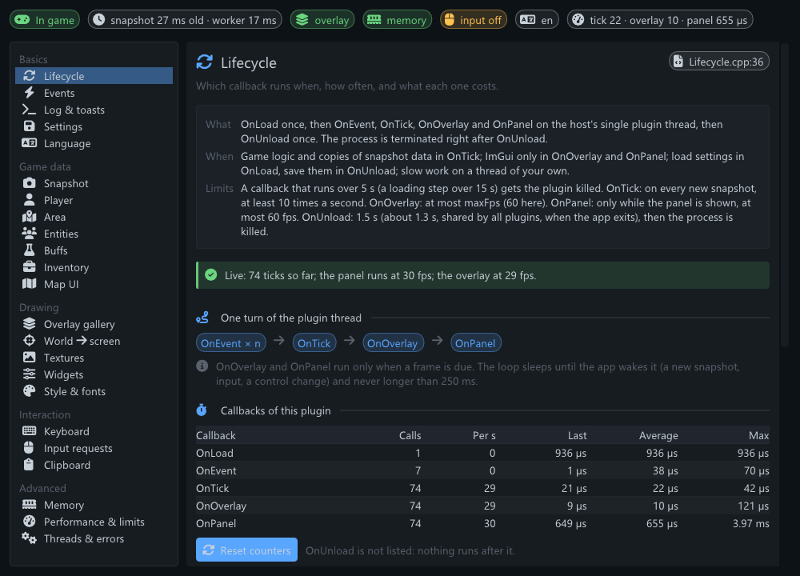
*Lifecycle. Every page: title and summary (with the source chip at the right of the title), What /
When / Limits, a live status line, the demo, and at the bottom the full source chip with Copy
snippet.*

| | |
|---|---|
| 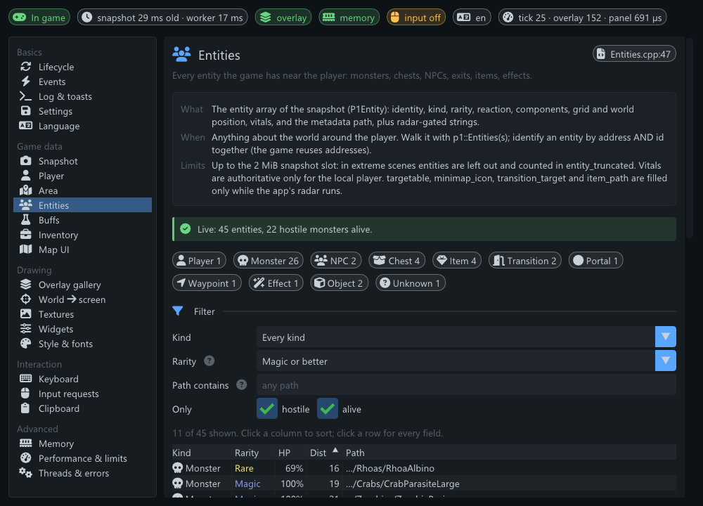 | 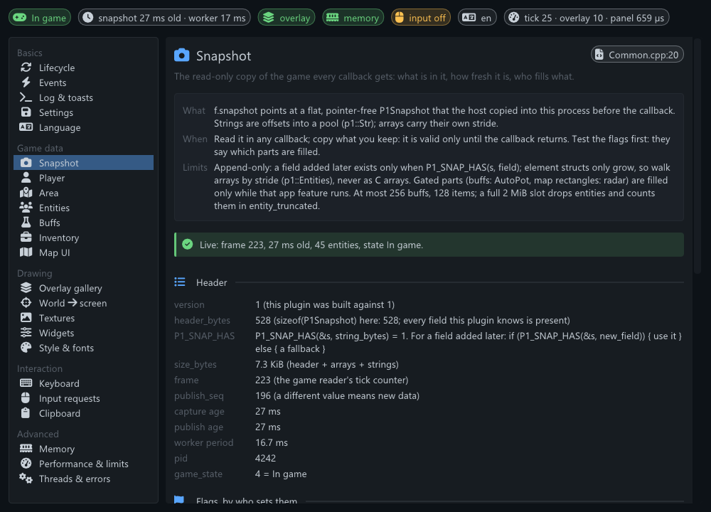 |
| **Entities**: counts by kind, a filter form, a sortable clipped table; the overlay rings the entity the card shows. | **Snapshot**: the header, every flag with who sets it, the server values, the arrays and their strides. |
| 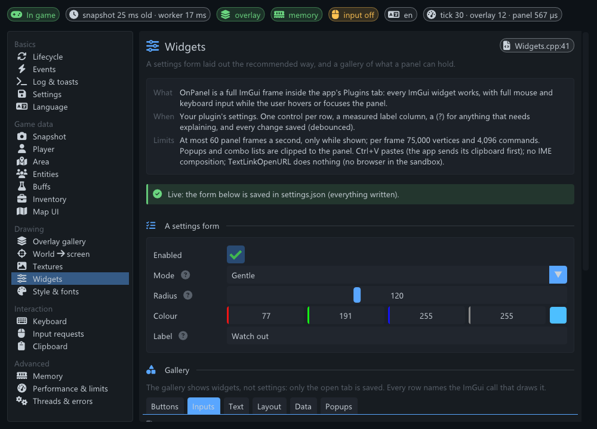 | 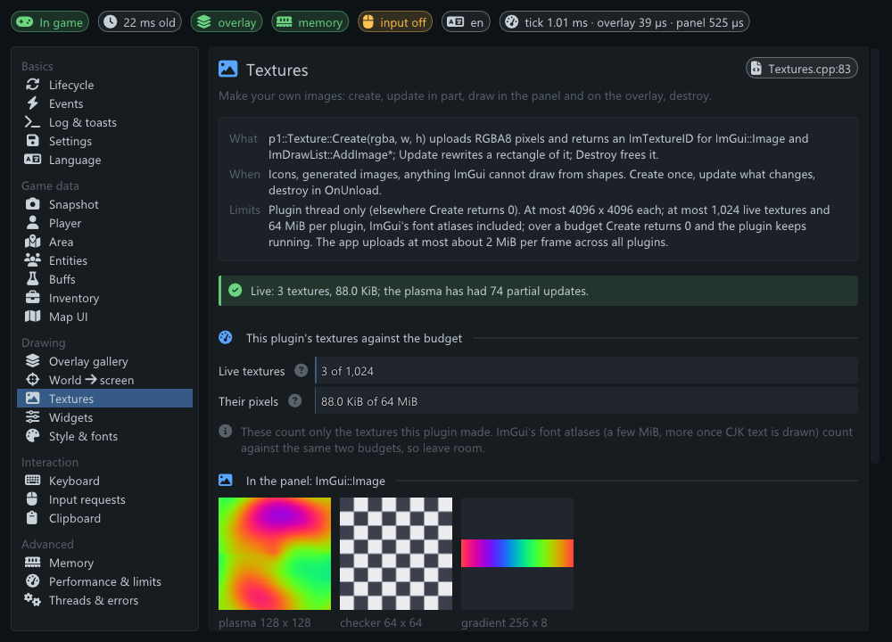 |
| **Widgets**: the recommended settings form (measured labels, help markers), then a gallery in tabs. | **Textures**: the plugin's textures against the 1,024 / 64 MiB budget, and the animated plasma. |
| 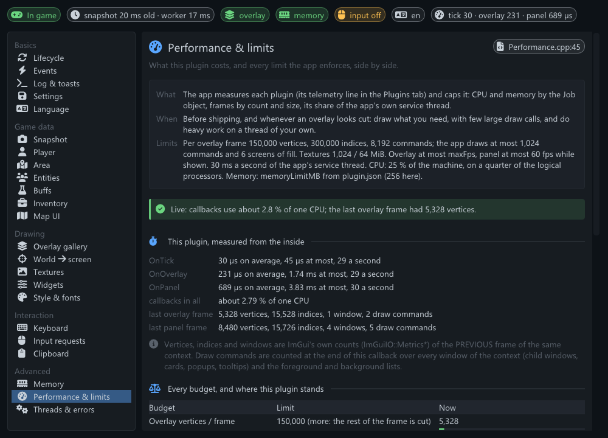 | 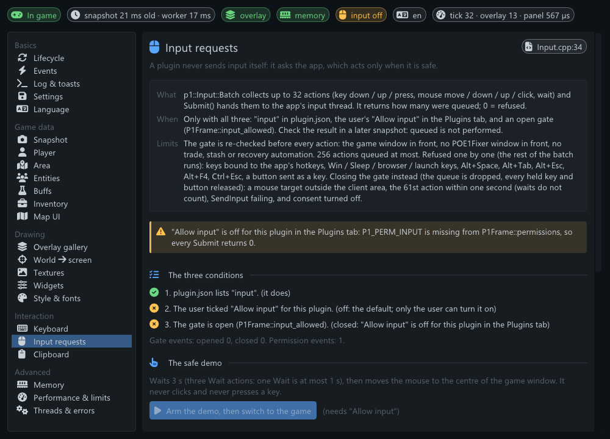 |
| **Performance & limits**: this plugin's costs from the inside, then every app budget with a usage bar. | **Input requests**: the three conditions, why the gate is closed right now, and the safe demo. |
| 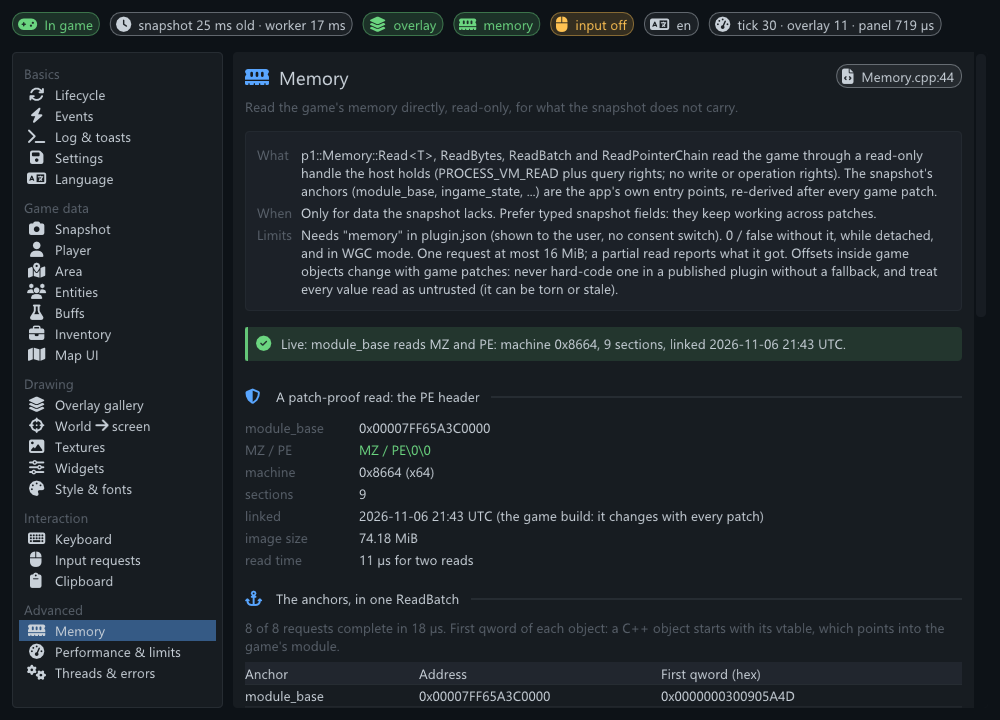 | 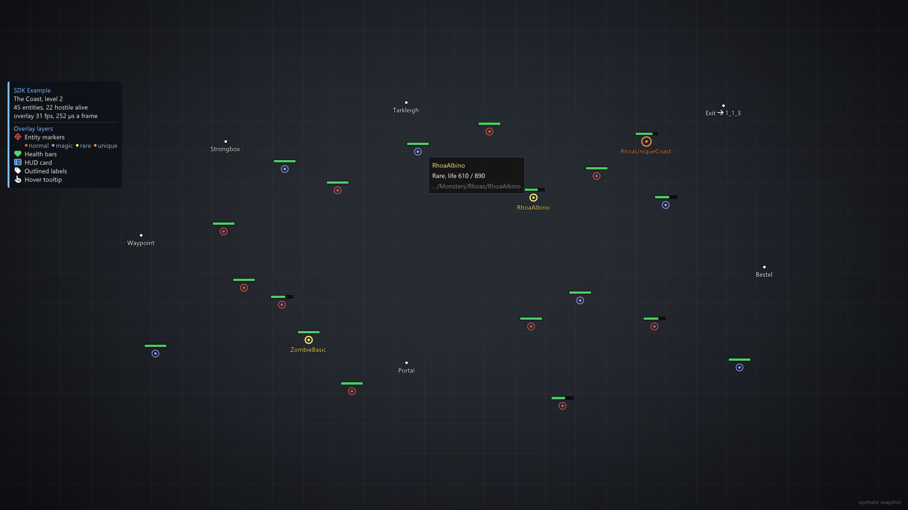 |
| **Memory**: a patch-proof PE header read, one `ReadBatch` of the anchors, a hex viewer, a pointer chain. | **Overlay**: rarity markers, health bars, outlined labels, the HUD card with its legend, a hover tooltip. |
| 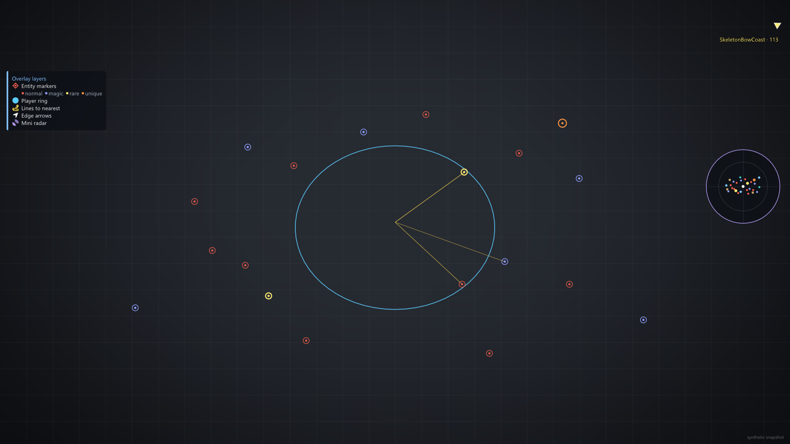 | 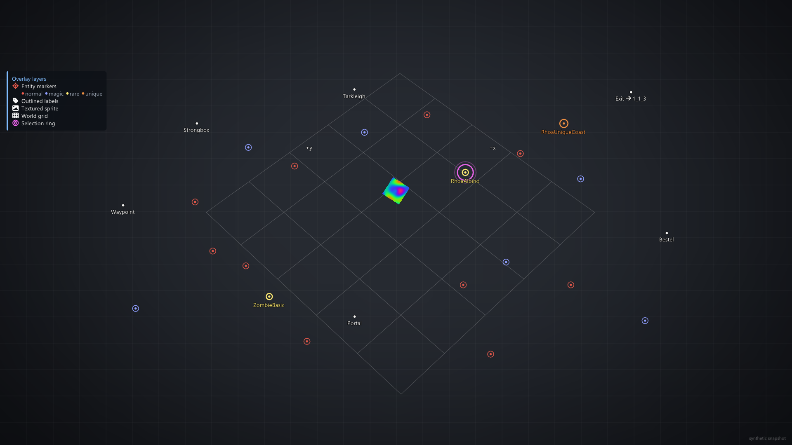 |
| **Overlay**: a world-space ring, lines to the nearest monsters, a labelled edge arrow, the mini radar. | **Overlay**: the projected 5 x 5 world grid, the Entities lesson's selection ring, a textured sprite. |

## The lessons

Every lesson page has the same five parts, in this order: a title with a one-line summary; **What /
When / Limits** (what the API does, when to use it, and the app's limits in numbers); a **status
line** that is never blank (either `Live: <the key fact>` or the exact reason the demo is empty right
now); the **demo**; and the **source chip** with **Copy snippet**, a verbatim excerpt of the lesson's
own compiled code.

| Group | # | Lesson | What it teaches | Source |
|---|---|---|---|---|
| **Basics** | 1 | Lifecycle (`lifecycle`) | Which callback runs when, how often, and what each one costs. | [Lifecycle.cpp](Plugins/ExamplePlugin/src/lessons/Lifecycle.cpp) |
|  | 2 | Events (`events`) | What changed since the last tick: attach, game state, area, character, focus, panel, consent. | [Events.cpp](Plugins/ExamplePlugin/src/lessons/Events.cpp) |
|  | 3 | Log & toasts (`logging`) | p1::Log writes a line to this plugin's log; p1::Notify shows a toast in the app. | [Logging.cpp](Plugins/ExamplePlugin/src/lessons/Logging.cpp) |
|  | 4 | Settings (`settings`) | Keep settings in JSON files in your one writable folder, and never lose a user's file. | [Settings.cpp](Plugins/ExamplePlugin/src/lessons/Settings.cpp) |
|  | 5 | Language (`language`) | Show your panel in the user's language, and fall back to English for anything else. | [Language.cpp](Plugins/ExamplePlugin/src/lessons/Language.cpp) |
| **Game data** | 6 | Snapshot (`snapshot`) | The read-only copy of the game every callback gets: what is in it, how fresh it is, who fills what. | [Snapshot.cpp](Plugins/ExamplePlugin/src/lessons/Snapshot.cpp) |
|  | 7 | Player (`player`) | The local player: life, energy shield, mana and their reservation, position, current action. | [Player.cpp](Plugins/ExamplePlugin/src/lessons/Player.cpp) |
|  | 8 | Area (`area`) | Where the player is: the area's name, id, level and kind, and a history built from events. | [Area.cpp](Plugins/ExamplePlugin/src/lessons/Area.cpp) |
|  | 9 | Entities (`entities`) | Every entity the game has near the player: monsters, chests, NPCs, exits, items, effects. | [Entities.cpp](Plugins/ExamplePlugin/src/lessons/Entities.cpp) |
|  | 10 | Buffs (`buffs`) | The buffs and debuffs on the player, with time left, charges and the flask that gave them. | [Buffs.cpp](Plugins/ExamplePlugin/src/lessons/Buffs.cpp) |
|  | 11 | Inventory (`inventory`) | The player's main inventory: which of its 12 x 5 cells are taken, and by which item. | [Inventory.cpp](Plugins/ExamplePlugin/src/lessons/Inventory.cpp) |
|  | 12 | Map UI (`mapui`) | Where the game draws its large map and minimap, to place your own drawing on top of them. | [MapUi.cpp](Plugins/ExamplePlugin/src/lessons/MapUi.cpp) |
| **Drawing** | 13 | Overlay gallery (`overlay`) | Drawing over the game: markers, bars, world-space shapes, edge arrows, cards, labels, a tooltip, a radar and a sprite. | [Overlay.cpp](Plugins/ExamplePlugin/src/lessons/Overlay.cpp) |
|  | 14 | World → screen (`w2s`) | Turn a position in the game world into the pixel where the game shows it. | [WorldToScreen.cpp](Plugins/ExamplePlugin/src/lessons/WorldToScreen.cpp) |
|  | 15 | Textures (`textures`) | Make your own images: create, update in part, draw in the panel and on the overlay, destroy. | [Textures.cpp](Plugins/ExamplePlugin/src/lessons/Textures.cpp) |
|  | 16 | Widgets (`widgets`) | A settings form laid out the recommended way, and a gallery of what a panel can hold. | [Widgets.cpp](Plugins/ExamplePlugin/src/lessons/Widgets.cpp) |
|  | 17 | Style & fonts (`style`) | Look like the app: its theme's colours and sizes, its fonts, Font Awesome icons, any script. | [Style.cpp](Plugins/ExamplePlugin/src/lessons/Style.cpp) |
| **Interaction** | 18 | Keyboard (`keyboard`) | Read the keys the player holds in the game, and react to a press of your own hotkey. | [Keyboard.cpp](Plugins/ExamplePlugin/src/lessons/Keyboard.cpp) |
|  | 19 | Input requests (`input`) | A plugin never sends input itself: it asks the app, which acts only when it is safe. | [Input.cpp](Plugins/ExamplePlugin/src/lessons/Input.cpp) |
|  | 20 | Clipboard (`clipboard`) | Copy text for the user (a build link, a summary) and accept text they paste into your panel. | [Clipboard.cpp](Plugins/ExamplePlugin/src/lessons/Clipboard.cpp) |
| **Advanced** | 21 | Memory (`memory`) | Read the game's memory directly, read-only, for what the snapshot does not carry. | [Memory.cpp](Plugins/ExamplePlugin/src/lessons/Memory.cpp) |
|  | 22 | Performance & limits (`performance`) | What this plugin costs, and every limit the app enforces, side by side. | [Performance.cpp](Plugins/ExamplePlugin/src/lessons/Performance.cpp) |
|  | 23 | Threads & errors (`threads`) | Do slow work on a thread of your own, and see what happens when a callback throws. | [Threads.cpp](Plugins/ExamplePlugin/src/lessons/Threads.cpp) |

The plugin's own README, [Plugins/ExamplePlugin/README.md](Plugins/ExamplePlugin/README.md), explains
how the code is laid out, the overlay layers, and its `settings.json`.

## Build

Requirements:

- Windows 10 or 11, x64.
- Visual Studio 2022 with the **Desktop development with C++** workload: the **v143** toolset and a
  Windows SDK. The example is C++20; the SDK headers need C++17 or later.
- Python 3 only to regenerate the snippet table (see below). Building needs no Python.

Steps:

1. Open `POE1ExamplePlugin.sln`.
2. Select the **Release | x64** configuration and build the solution.
3. The plugin folder is `x64\Release\Plugins\ExamplePlugin\`: `ExamplePlugin.dll`, `plugin.json`, and
   `ExamplePlugin.pdb`. The DLL records only the PDB's file name (`/PDBALTPATH:%_PDB%`), never a
   path of your machine. Keep the PDB of every build you ship: it turns a user's crash dump into a
   call stack.

From a Developer Command Prompt for VS 2022:

```bat
msbuild POE1ExamplePlugin.sln -p:Configuration=Release -p:Platform=x64
```

The project builds at `/W4` with no warnings. **Dbg | x64** is the debug configuration. It links the
debug C runtime (`/MDd`), which exists only on machines with Visual Studio, and its assertions record
the full paths of your source files, so give users Release builds only.

Each lesson's **Copy snippet** text is compiled into the DLL from
`Plugins/ExamplePlugin/src/generated/Snippets.inc`. That file is generated from the code between
`// [snippet:<id>]` and `// [/snippet]` markers and committed. After you edit such a block, run
`python Plugins/ExamplePlugin/tools/gen_snippets.py`; with `--check` it exits non-zero when the
table is stale.

## Install

1. Copy `x64\Release\Plugins\ExamplePlugin` into `<POE1Fixer folder>\Plugins\`, so that you get
   `Plugins\ExamplePlugin\ExamplePlugin.dll` and `Plugins\ExamplePlugin\plugin.json`. Create the
   `Plugins` folder if it does not exist: the app never creates or deletes it.
2. In POE1Fixer, open the **Plugins** tab and press **Rescan** (or restart the app). Plugins start
   once you are signed in.
3. Select **SDK Example** and turn on **Enable**. Every plugin starts disabled.
4. **Allow input** is optional. Without it every lesson works; only the Input lesson's safe demo
   cannot be armed, and its page says why.

The panel appears under the plugin's details in the Plugins tab: pick a lesson on the left. The
plugin keeps its settings in `<POE1Fixer folder>\Configs\plugins\data\example\settings.json`.
To install a new build, disable the plugin first (its DLL is locked while its process runs), replace
the files, press **Rescan**, and enable it again.

## Permissions

`plugin.json` asks for `"memory"` and `"input"`. The Plugins tab shows both to the user.

- **memory**: read-only reads of the game's memory. Only the Memory lesson uses it, and only while its
  page is open: the PE header at the game module's base address, the snapshot's anchor addresses,
  and the addresses and offsets you type in. No game offset is hard-coded anywhere.
- **input**: inert until you turn on **Allow input** for this plugin. Even then the plugin sends
  input only when you arm the Input lesson's safe demo: three one-second waits, then one mouse move
  to the centre of the game window. It never clicks and never presses a key.

The plugin uses no network.

## Compatibility

| | |
|---|---|
| Plugin ABI | v1: `P1_ABI_VERSION` in `p1_abi.h`; `"sdk": 1` in `plugin.json` |
| Snapshot | v1: `P1_SNAPSHOT_VERSION` in `p1_snapshot.h`. A newer app still runs a plugin built for an older snapshot version |
| Dear ImGui | **1.92.8** (`IMGUI_VERSION_NUM` 19280), pinned in `PluginSDK/imgui/` |
| Toolset | Visual Studio 2022 (v143), x64 |

- **Never replace the SDK's ImGui.** Compile exactly the copy in `PluginSDK/imgui/` into your DLL
  (`imgui.cpp`, `imgui_draw.cpp`, `imgui_tables.cpp`, `imgui_widgets.cpp`, no backends), keep its
  `imconfig.h` unchanged, and define no `IMGUI_*` or `ImDrawIdx` macros of your own. Do not upgrade
  it to a newer Dear ImGui release either. The plugin host shares its ImGui context with your DLL,
  so at load it compares the ImGui version and the sizes of seven ImGui structs with its own, and
  reports a plugin that differs as **Incompatible**.
- The app's own ImGui is separate: the app never runs plugin ImGui code, it receives finished draw
  data. An app update therefore breaks plugins only when it changes `P1_ABI_VERSION` or the pinned
  ImGui; then rebuild against the SDK of that app version. Compatible additions keep the ABI version:
  structs only grow at the end, and every struct starts with `size_bytes`.
- Read snapshot arrays by stride (`p1::Entities`, `p1_entity_at`), never as C arrays, and ignore
  enum values, event types and flag bits you do not know.

## Start your own plugin

1. Copy `Plugins/ExamplePlugin` to `Plugins/<YourPlugin>`, rename the `.vcxproj`, give it a new
   `<ProjectGuid>`, and add it to a solution of your own (or to this one).
2. Choose an id and write it in two places that must match: `"id"` in `plugin.json` and the second
   argument of `P1_PLUGIN(...)`. Set `name`, `version`, `author`, `description` and `dll` too.
3. Keep what the project file does: the include directories `PluginSDK\include` and
   `PluginSDK\imgui`; the four ImGui core `.cpp` files compiled into the DLL; `/EHsc` (never
   `/EHa`); `/utf-8`; the post-build step that copies `plugin.json` next to the DLL; a PDB in Release
   with `/PDBALTPATH:%_PDB%`.
4. Replace the lessons with your own code, or start from the whole minimal plugin below. It is the
   Lifecycle lesson's snippet, compiled with every build of the example, plus the two lines a file of
   its own needs:

   ```cpp
   #include <p1sdk/p1sdk.hpp>
   #include <string>

   // A whole plugin, every callback in the order the host calls it. It uses only
   // the SDK and ImGui: copy it into your .cpp and end that file with
   //   P1_PLUGIN(MinimalPlugin, "my_id", "My plugin", "1.0.0", "Me", "What it does")
   // (it is compiled here, so it cannot rot, but not exported: one DLL is one plugin,
   // and this DLL's P1_PLUGIN names ExamplePlugin in Plugin.cpp).
   class MinimalPlugin final : public p1::Plugin {
   public:
       bool OnLoad() override {                       // once, first; false = refuse to run
           ImTextInitClassifiers();                   // word wrap in this DLL's ImGui copy
           p1::Log(P1_LOG_INFO, "loaded; app language %s", HostApi().language);
           return true;
       }
       void OnEvent(const P1Event& e) override {      // before the OnTick of the same turn
           if (e.type == P1_EV_AREA_CHANGED) m_newArea = true;   // no frame here: note it
       }
       void OnTick(const P1Frame& f) override {       // game logic, no ImGui
           const P1Snapshot& s = *f.snapshot;         // gone when the callback returns:
           if (m_newArea && (s.flags & P1_SNAP_ATTACHED)) {   // COPY what you keep
               m_area = p1::Str(s, s.area.name);
               m_newArea = false;
           }
           ++m_ticks;
       }
       void OnOverlay(const P1Frame&) override {      // ImGui over the game, client pixels
           ImGui::GetWindowDrawList()->AddText(ImVec2(16.0f, 16.0f), IM_COL32_WHITE, m_area.c_str());
       }
       void OnPanel(const P1Frame&) override {        // ImGui in the Plugins tab, while shown
           ImGui::Text("%llu ticks; area: %s", m_ticks, m_area.c_str());
       }
       void OnUnload() override {}                    // last: stop threads (bounded), save
   private:
       bool m_newArea = true;
       std::string m_area;
       unsigned long long m_ticks = 0;
   };

   P1_PLUGIN(MinimalPlugin, "my_id", "My plugin", "1.0.0", "Me", "What it does")
   ```

5. Keep `ImTextInitClassifiers();` in `OnLoad`. Dear ImGui fills its word-wrap tables only in the copy
   that builds the font atlas, which is the host's; without the call, `TextWrapped` in your copy
   breaks lines in the middle of words.
6. Ask only for the permissions you use, and say in `description` what your plugin reads and what it
   sends over the network, if anything.

## Documentation

- [docs/PluginDevelopmentGuide.md](docs/PluginDevelopmentGuide.md): the full developer guide. The
  sandbox, `plugin.json`, the lifecycle and threads, the frame and snapshot reference, drawing and its
  limits, settings and files, input requests, memory reads, logging, debugging, ABI rules and a FAQ.
  In Russian: [docs/PluginDevelopmentGuide_ru.md](docs/PluginDevelopmentGuide_ru.md).
- [Plugins/ExamplePlugin/README.md](Plugins/ExamplePlugin/README.md): how the example is built, its
  overlay layers and `settings.json`, rules of thumb.
- [PluginSDK/include/p1sdk/](PluginSDK/include/p1sdk/): the authoritative contract, the C headers
  `p1_abi.h` and `p1_snapshot.h`, and `p1sdk.hpp`, the header-only C++ wrapper over them.

## Repository layout

```text
POE1ExamplePlugin.sln          the solution: the ExamplePlugin project, Dbg|x64 and Release|x64
PluginSDK/
  include/p1sdk/               p1_abi.h, p1_snapshot.h (the C contract), p1sdk.hpp (the C++ wrapper)
  imgui/                       the pinned Dear ImGui 1.92.8 core, its imconfig.h, IconsFontAwesome6.h
  third_party/nlohmann/        JSON for Modern C++ 3.11.3 (used by p1::Settings)
Plugins/ExamplePlugin/         the plugin: plugin.json, the project, src/, tools/, docs/screenshots/
docs/                          the plugin development guide, in English and in Russian
THIRD_PARTY_NOTICES.md         the licenses of the bundled third-party code
```

## Third-party code

Dear ImGui (MIT), JSON for Modern C++ (MIT) and IconFontCppHeaders (zlib) are bundled in `PluginSDK/`;
the Font Awesome icon names refer to Font Awesome Free. See
[THIRD_PARTY_NOTICES.md](THIRD_PARTY_NOTICES.md).

<!-- Generated from the POE1Fixer source tree by its plugin SDK export script. Edit the source there,
     not this file. -->
